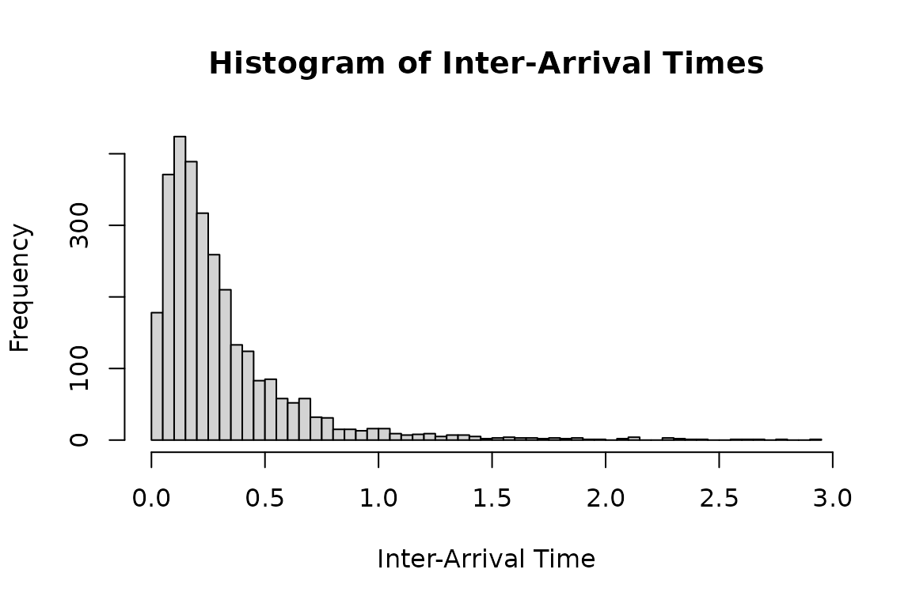
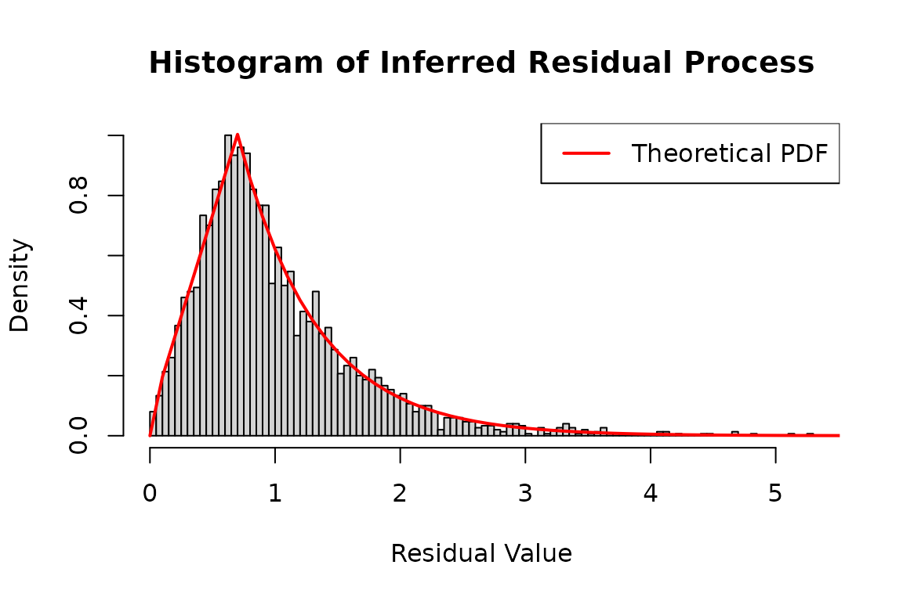
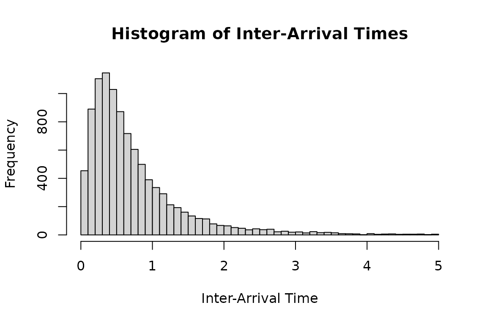
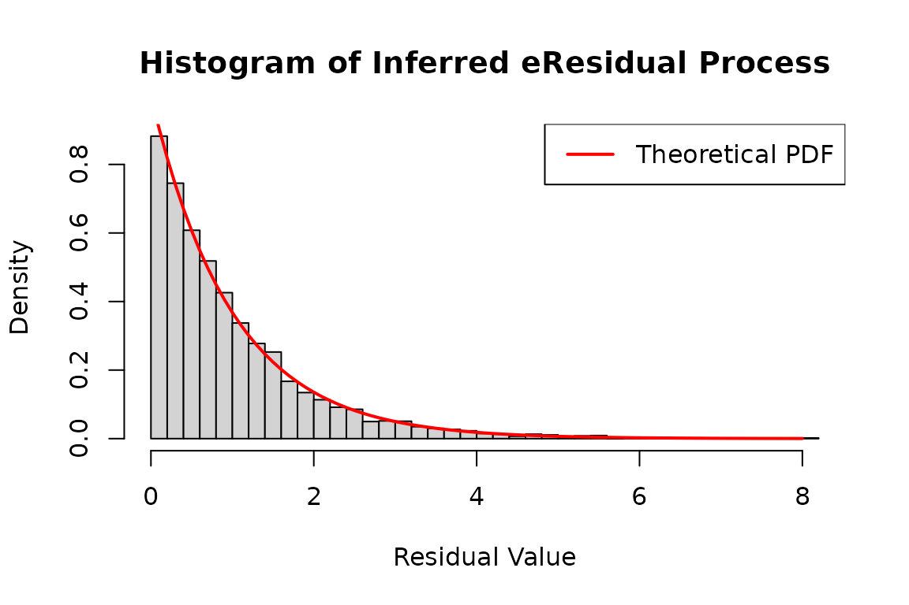
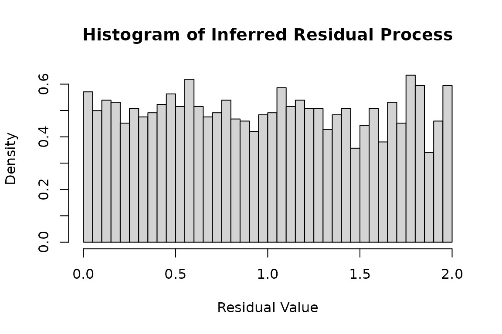

# Legacy emhawkes FRPP examples

These examples were copied from the flexible-residual section of the
[emhawkes Extended
examples](https://ksublee.github.io/emhawkes/articles/extended_example.html#point-processes-with-flexible-residuals).
They preserve the original `hspec`, `set_residual()`, `hsim()` and
`hfit()` interface as a compatibility reference. This vignette is
distributed with frpp; its calculations deliberately use emhawkes. For
the frpp interface, use [FRPP
examples](https://ksublee.github.io/frpp/articles/frpp-examples.md),
with [`fspec()`](https://ksublee.github.io/frpp/reference/frpp_spec.md),
[`fsim()`](https://ksublee.github.io/frpp/reference/operations.md) and
[`ffit()`](https://ksublee.github.io/frpp/reference/ffit.md).

FRPP-specific development is moving to frpp. Existing emhawkes
residual-law functions remain available for simple uses and
compatibility during the transition. Hawkes goodness-of-fit residual
diagnostics remain in emhawkes. No existing function is removed or
deprecated by this documentation change.

The original kernel parameters and simulation sizes are retained. A
starting seed is supplied here so the copied section runs independently
of preceding Hawkes examples. The original two-dimensional seed is also
retained. Automatic initialization currently selects zero components for
these residual-law models.

A [matched 10,000-row
validation](https://ksublee.github.io/frpp/articles/legacy-fit-validation.html)
records the estimates, restoration, curvature diagnostics and elapsed
times under explicitly matched optimizer controls.

The 10,000-row maximum-likelihood fit and its reconstruction are opt-in.
Set `FRPP_RUN_LONG_EXAMPLES=true` before building this vignette to run
them; they require the optional maxLik package. The simulation,
likelihood and residual plots run in the normal build.

## One-dimensional model

The following example defines a point process with a custom residual
distribution. For details, see [Self and mutually exciting point process
embedding flexible residuals and intensity with discretely Markovian
dynamics](https://link.springer.com/article/10.1007/s11009-025-10159-5).
The residual density has a trapezoidal section and an exponential tail.
The `dresidual`, `presidual`, and `qresidual` functions receive their
distribution parameters through the `param` vector. The ordinary Hawkes
model is the special case with an exponential residual distribution of
rate 1. Use `set_residual` to wrap the distribution functions with
log-density and tail-probability support.

``` r

mu1_d <- 0.5; alpha1_d <- 1; beta1_d <- 1.2; a <- 0.7; ell <- 1.6
hspec1_d <- set_residual(
  new("hspec", mu = mu1_d, alpha = alpha1_d, beta = beta1_d),
  param = c(a = a, ell = ell),
  dresidual = dtzexp, presidual = ptzexp,
  qresidual = qtzexp, rresidual = rtzexp
)
```

``` r

dh1_real <- hsim(hspec1_d, size = 3000)
#> Initial intensity components: auto -> zero (no supported unconditional mean formula for this model). Supplying lambda_component0 explicitly is recommended for this model.
hist(
  dh1_real$inter_arrival[dh1_real$inter_arrival < 3],
  breaks = 50,
  main = "Histogram of Inter-Arrival Times",
  xlab = "Inter-Arrival Time",
  ylab = "Frequency"
)
```



Use `logLik` to evaluate the observed inter-arrival times under
`hspec1_d`. Setting `infer = TRUE` also returns the intensity and
residual processes in `infer_res_dh1`.

``` r

# Infer the residual process using the log-likelihood method
# 'infer_res_dh1' contains the inferred process data based on the inter-arrival times
infer_res_dh1 <- logLik(hspec1_d, inter_arrival = dh1_real$inter_arrival, infer = TRUE)

# Plot a histogram of the inferred residual process
hist(
  infer_res_dh1$res_process1,
  breaks = 100,
  probability = TRUE,
  main = "Histogram of Inferred Residual Process",
  xlab = "Residual Value",
  ylab = "Density"
)

x <- seq(0, 8, 0.1)

lines(
  x,
  dtzexp(x, a = a, ell = ell),
  col = 'red',
  lwd = 2
)

# Add legend for clarity
legend("topright", legend = "Theoretical PDF", col = "red", lwd = 2)
```



## Two-dimensional model

The same approach extends to multiple dimensions, using parameter
matrices as in a multivariate Hawkes model.

``` r

mu2_d <- matrix(c(0.3), nrow = 2)
alpha2_d <- matrix(c(0.5, 0.8, 0.8, 0.5), nrow = 2, byrow = TRUE)
beta2_d <- matrix(c(1.5, 1.5, 1.5, 1.5), nrow = 2, byrow = TRUE)
a <- 0.7; ell <- 1.6

hspec2_du <- set_residual(
  new("hspec", mu = mu2_d, alpha = alpha2_d, beta = beta2_d),
  param = c(a = a, ell = ell),
  dresidual = dtzexp, presidual = ptzexp,
  qresidual = qtzexp, rresidual = rtzexp
)
print(hspec2_du)
#> An object of class "hspec" of 2-dimensional Hawkes process
#> 
#> Slot mu: 
#>      [,1]
#> [1,]  0.3
#> [2,]  0.3
#> 
#> Slot alpha: 
#>      [,1] [,2]
#> [1,]  0.5  0.8
#> [2,]  0.8  0.5
#> 
#> Slot beta: 
#>      [,1] [,2]
#> [1,]  1.5  1.5
#> [2,]  1.5  1.5
#> 
#> Slot rresidual: 
#> function (size, param = c(a = 0.7, ell = 1.6)) 
#> {
#>     do.call(rresidual, c(list(size), distribution_parameters(rresidual, 
#>         param)))
#> }
#> <environment: 0x563fad148d90>
#> 
#> Slot dresidual: 
#> function (x, param = c(a = 0.7, ell = 1.6), log = FALSE) 
#> {
#>     residual_density(dresidual, x, log = log, params = distribution_parameters(dresidual, 
#>         param))
#> }
#> <environment: 0x563fad148d90>
#> 
#> Slot presidual: 
#> function (q, param = c(a = 0.7, ell = 1.6), lower.tail = TRUE, 
#>     log.p = FALSE) 
#> {
#>     residual_cdf(presidual, q, lower.tail = lower.tail, log.p = log.p, 
#>         params = distribution_parameters(presidual, param))
#> }
#> <environment: 0x563fad148d90>
#> 
#> Slot qresidual: 
#> function (p, param = c(a = 0.7, ell = 1.6), lower.tail = TRUE, 
#>     log.p = FALSE) 
#> {
#>     residual_quantile(qresidual, p, lower.tail = lower.tail, 
#>         log.p = log.p, params = distribution_parameters(qresidual, 
#>             param))
#> }
#> <environment: 0x563fad148d90>
```

The following histogram shows inter-arrival times from a model with
`tzexp` residuals.

``` r

set.seed(1107)
duh2_real <- hsim(hspec2_du, size = 10000)
#> Initial intensity components: auto -> zero (no supported unconditional mean formula for this model). Supplying lambda_component0 explicitly is recommended for this model.
# Plot a histogram of the inter-arrival times less than 5
hist(
  duh2_real$inter_arrival[duh2_real$inter_arrival < 5],
  breaks = 50,
  main = "Histogram of Inter-Arrival Times",
  xlab = "Inter-Arrival Time",
  ylab = "Frequency"
)
```



Use `logLik` with `infer = TRUE` to recover the intensity and residual
processes.

``` r

infer_res_dh2 <- logLik(hspec2_du,
                        inter_arrival = duh2_real$inter_arrival,
                        type = duh2_real$type, infer = TRUE)
```

Under a correctly specified model, the inferred residuals follow the
specified residual distribution.

``` r

# Plot a histogram of the inferred residual process
hist(
  infer_res_dh2$res_process2,
  breaks = 50,
  probability = TRUE,
  main = "Histogram of Inferred Residual Process",
  xlab = "Residual Value",
  ylab = "Density"
)

# Generate a sequence of x values for plotting the theoretical distribution
x <- seq(0, 8, 0.1)

# Add a line to the histogram representing the theoretical density function
lines(
  x,
  dtzexp(x, a = a, ell = ell),
  col = 'red',
  lwd = 2
)

# Add legend for clarity
legend("topright", legend = "Theoretical PDF", col = "red", lwd = 2)
```


The transformed residuals in `eres_process1` follow an exponential
distribution with rate 1 under a correctly specified model.

``` r

hist(
  infer_res_dh2$eres_process1,
  breaks = 50,
  probability = TRUE,
  main = "Histogram of Inferred eResidual Process",
  xlab = "Residual Value",
  ylab = "Density"
)

# Generate a sequence of x values for plotting the theoretical distribution
x <- seq(0, 8, 0.1)

# Add a line to the histogram representing the theoretical density function
lines(
  x,
  dexp(x),
  col = 'red',
  lwd = 2
)

# Add legend for clarity
legend("topright", legend = "Theoretical PDF", col = "red", lwd = 2)
```



Use `hfit` for maximum likelihood estimation. The distribution requires
`0 < a <= 3`, `ell > 0`, and a nonnegative density. The last condition
is nonlinear, so the custom objective below checks each candidate with
`dtzexp` and returns `-Inf` when the distribution is invalid.

``` r

residual_loglik <- function(object, inter_arrival, type, param) {
  valid <- tryCatch({
    dtzexp(1, a = param["a"], ell = param["ell"])
    TRUE
  }, error = function(e) FALSE)
  if (!valid) return(-Inf)
  suppressMessages(logLik(object, inter_arrival = inter_arrival, type = type))
}
constraints <- list(
  ineqA = rbind(diag(6), c(0, 0, 0, 0, -1, 0)),
  ineqB = c(rep(0, 6), 3)
)
mle_dh <- hfit(hspec2_du,
               inter_arrival = duh2_real$inter_arrival,
               type = duh2_real$type,
               mylogLik = residual_loglik,
               constraints = constraints)
summary(mle_dh)
```

Hawkes curvature stabilization does not change this custom FRPP
objective. The moving transition point of `tzexp` can make numerical
Hessians step dependent. A successful optimizer return code does not
validate the reported Wald standard errors. See the [fit diagnostic
report](https://github.com/ksublee/emhawkes/blob/main/tools/fit-diagnostics.md)
for the one-sided derivative and profile checks.

These constraints keep the six parameters nonnegative and enforce
`a <= 3`, the upper limit of the trapezoid-exponential distribution. The
parameter order is `mu1`, `alpha1.1`, `alpha1.2`, `beta1.1`, `a`, and
`ell`.

Reconstruction also updates the residual density, distribution,
quantile, and generator functions with the shared estimates of `a` and
`ell`. The custom objective and optimization constraints remain part of
the fitting step; [`logLik()`](https://rdrr.io/r/stats/logLik.html)
evaluates the restored model’s residual-distribution likelihood.

``` r

estimated_dh <- fitted_hspec(mle_dh)
initial_dh <- fit_initial_state(mle_dh)
formals(estimated_dh@rresidual)$param
inferred_dh <- do.call(logLik, c(list(object = estimated_dh,
  inter_arrival = duh2_real$inter_arrival, type = duh2_real$type, infer = TRUE), initial_dh))
c(fitted = as.numeric(logLik(mle_dh)), restored = inferred_dh$loglikelihood)
```

## Uniform residuals

The following example uses a uniform residual distribution on
$`[0, 2]`$.

``` r


#set.seed(117)
mu2_d <- matrix(c(0.5), nrow = 2)
alpha2_d <- matrix(c(0.3, 0.3, 0.3, 0.3), nrow = 2, byrow = TRUE)
beta2_d <- matrix(c(1.2, 1.2, 1.2, 1.2), nrow = 2, byrow = TRUE)

hspec2_du <- new("hspec", mu=mu2_d, alpha=alpha2_d, beta=beta2_d,
                 rresidual = function(size) runif(n=size, 0, 2),
                 dresidual = function(x, param = numeric(0), log = FALSE)
                   dunif(x, 0, 2, log = log),
                 presidual = function(q, param = numeric(0), lower.tail = TRUE, log.p = FALSE)
                   punif(q, 0, 2, lower.tail = lower.tail, log.p = log.p),
                 qresidual = function(p, param = numeric(0), lower.tail = TRUE, log.p = FALSE)
                   qunif(p, 0, 2, lower.tail = lower.tail, log.p = log.p))

duh2_real <- hsim(hspec2_du, size = 5000)
```

Plot a histogram of the inferred residuals:

``` r


infer_res_duh2 <- logLik(hspec2_du,
                         inter_arrival = duh2_real$inter_arrival,
                         type = duh2_real$type, infer = TRUE)

hist(
  infer_res_duh2$res_process1,
  breaks = 50,
  probability = TRUE,
  main = "Histogram of Inferred Residual Process",
  xlab = "Residual Value",
  ylab = "Density"
)
```


