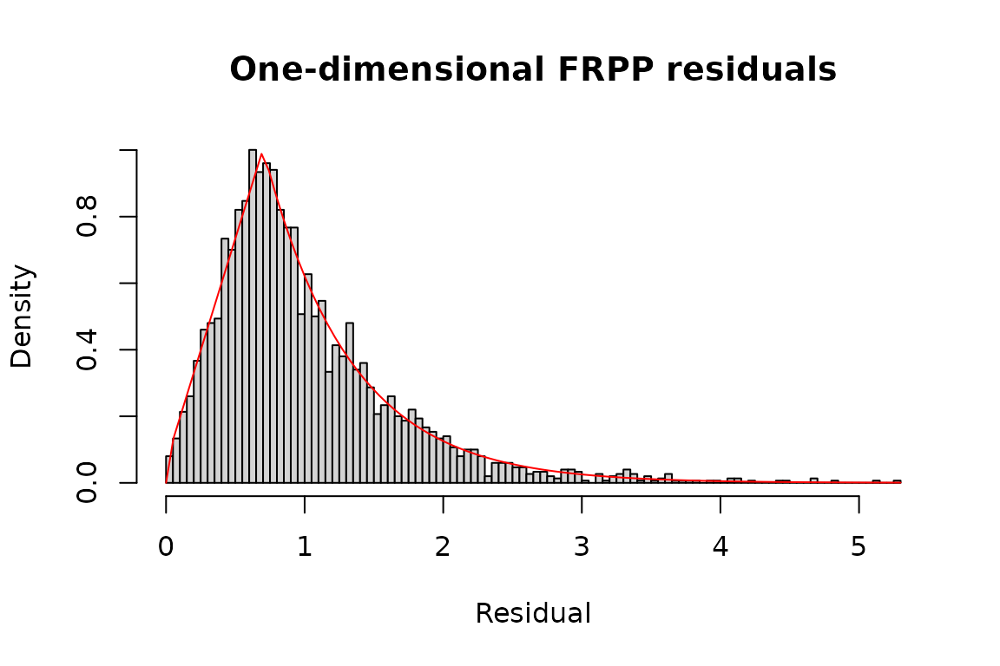
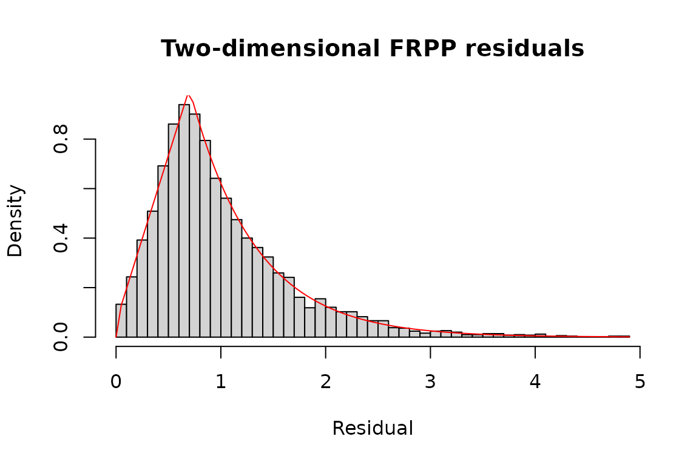
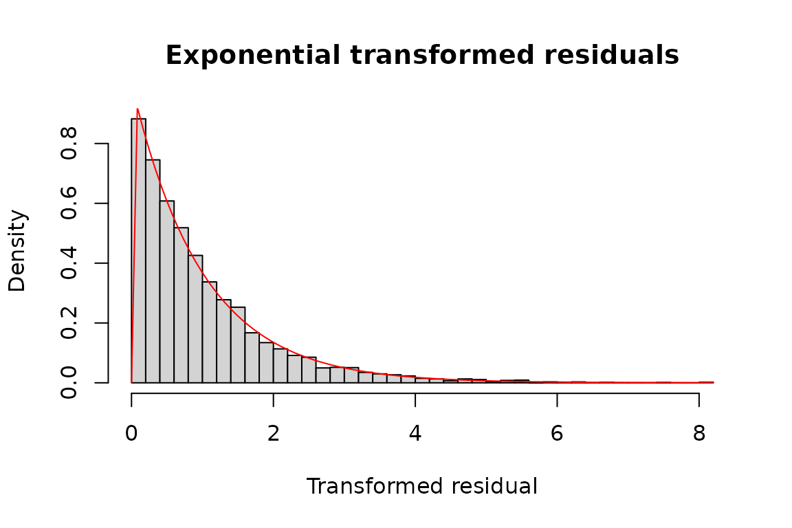
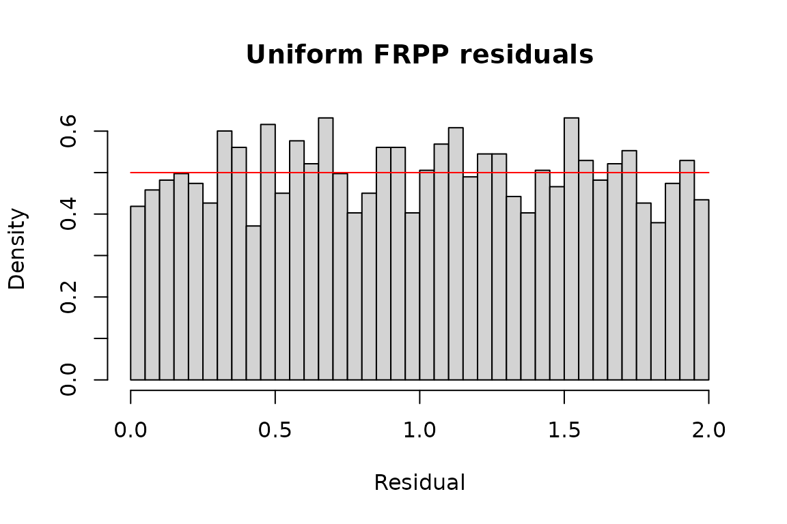

# FRPP examples migrated from emhawkes

These three examples come from the flexible-residual section of
`emhawkes`’s Extended examples. Kernel parameters and output sizes are
unchanged. The complete original emhawkes code, including its custom
fitting objective, is preserved in [Legacy emhawkes FRPP
examples](https://ksublee.github.io/frpp/articles/emhawkes-compatibility.md).
FRPP-specific functionality is planned to move here; simple residual-law
models remain supported by emhawkes during the transition.

Each simulation uses seed 1107 explicitly; the original one-dimensional
and uniform examples inherited their random state from earlier examples.
`size` includes the initial row. The initial component state is
explicitly zero.

The model contains a kernel and a residual law. The current simulation
and default `bridge` likelihood reuse public emhawkes functions. The
`state` backend assembles the FRPP likelihood from the public kernel
replay API, excluding the baseline. Kernel components are driving
quantities, rather than the conditional intensity of a general FRPP. All
dimensions redraw candidate residuals after every event.

The optional state comparisons require the public shared-kernel API in
GitHub development emhawkes 1.0.1.9000. When it is not installed,
simulations and bridge likelihoods still run, and state comparisons are
reported as unavailable rather than as successful checks.

## One dimension: trapezoid-exponential residuals

``` r

tz_law <- residual_law(c(a = 0.7, ell = 1.6),
  density = emhawkes::dtzexp, cdf = emhawkes::ptzexp,
  quantile = emhawkes::qtzexp, rng = emhawkes::rtzexp, name = "tzexp")
model_1d <- fspec(
  methods::new("hspec", mu = 0.5, alpha = 1, beta = 1.2), tz_law)
set.seed(1107)
path_1d <- fsim(model_1d, size = 3000, lambda_component0 = 0)
seed_1d <- .Random.seed
inferred_1d <- logLik(model_1d, path_1d$inter_arrival,
  lambda_component0 = 0, infer = TRUE)
state_1d <- if (has_kernel_api) logLik(model_1d, path_1d$inter_arrival,
  lambda_component0 = 0, infer = TRUE, backend = "state") else NULL
c(bridge = inferred_1d$loglikelihood,
  state = if (has_kernel_api) state_1d$loglikelihood else NA_real_)
#>   bridge    state 
#> 1114.393 1114.393
```

``` r

hist(inferred_1d$res_process1, breaks = 100, probability = TRUE,
  main = "One-dimensional FRPP residuals", xlab = "Residual")
curve(emhawkes::dtzexp(x, a = 0.7, ell = 1.6), add = TRUE, col = "red")
```



## Two dimensions: trapezoid-exponential residuals

``` r

kernel_2d <- methods::new("hspec", mu = c(0.3, 0.3),
  alpha = matrix(c(0.5, 0.8, 0.8, 0.5), 2, byrow = TRUE),
  beta = matrix(1.5, 2, 2))
model_2d <- fspec(kernel_2d, tz_law)
set.seed(1107)
path_2d <- fsim(model_2d, size = 10000, lambda_component0 = 0)
seed_2d <- .Random.seed
inferred_2d <- logLik(model_2d, path_2d$inter_arrival, path_2d$type,
  lambda_component0 = 0, infer = TRUE)
state_2d <- if (has_kernel_api) logLik(model_2d, path_2d$inter_arrival, path_2d$type,
  lambda_component0 = 0, infer = TRUE, backend = "state") else NULL
c(bridge = inferred_2d$loglikelihood,
  state = if (has_kernel_api) state_2d$loglikelihood else NA_real_)
#>    bridge     state 
#> -12413.76 -12413.76
```

``` r

hist(inferred_2d$res_process2, breaks = 50, probability = TRUE,
  main = "Two-dimensional FRPP residuals", xlab = "Residual")
curve(emhawkes::dtzexp(x, a = 0.7, ell = 1.6), add = TRUE, col = "red")
```



``` r

hist(inferred_2d$eres_process1, breaks = 50, probability = TRUE,
  main = "Exponential transformed residuals", xlab = "Transformed residual")
curve(stats::dexp(x), add = TRUE, col = "red")
```



## Two dimensions: uniform residuals

``` r

uniform_law <- residual_law(c(min = 0, max = 2),
  stats::dunif, stats::punif, stats::qunif, stats::runif, name = "Uniform(0,2)")
model_uniform <- fspec(methods::new("hspec", mu = c(0.5, 0.5),
  alpha = matrix(0.3, 2, 2), beta = matrix(1.2, 2, 2)), uniform_law)
set.seed(1107)
path_uniform <- fsim(model_uniform, size = 5000, lambda_component0 = 0)
seed_uniform <- .Random.seed
inferred_uniform <- logLik(model_uniform, path_uniform$inter_arrival,
  path_uniform$type, lambda_component0 = 0, infer = TRUE)
state_uniform <- if (has_kernel_api) logLik(model_uniform, path_uniform$inter_arrival,
  path_uniform$type, lambda_component0 = 0, infer = TRUE, backend = "state") else NULL
c(bridge = inferred_uniform$loglikelihood,
  state = if (has_kernel_api) state_uniform$loglikelihood else NA_real_)
#>    bridge     state 
#> -7287.486 -7287.486
```

``` r

hist(inferred_uniform$res_process1, breaks = 50, probability = TRUE,
  main = "Uniform FRPP residuals", xlab = "Residual")
curve(stats::dunif(x, 0, 2), add = TRUE, col = "red")
```



## Compare the original and migrated examples

The reference objects below use the original representation. Compare
every simulation field and the final RNG state exactly. The bridge must
return the same inference result. Independent state calculations use a
fixed numerical comparison tolerance of `1e-10`; their absolute
differences are also reported.

``` r

reference_1d <- emhawkes::set_residual(
  methods::new("hspec", mu = 0.5, alpha = 1, beta = 1.2),
  param = c(a = 0.7, ell = 1.6), dresidual = emhawkes::dtzexp,
  presidual = emhawkes::ptzexp, qresidual = emhawkes::qtzexp,
  rresidual = emhawkes::rtzexp)
reference_2d <- emhawkes::set_residual(
  methods::new("hspec", mu = c(0.3, 0.3),
    alpha = matrix(c(0.5, 0.8, 0.8, 0.5), 2, byrow = TRUE),
    beta = matrix(1.5, 2, 2)),
  param = c(a = 0.7, ell = 1.6), dresidual = emhawkes::dtzexp,
  presidual = emhawkes::ptzexp, qresidual = emhawkes::qtzexp,
  rresidual = emhawkes::rtzexp)
reference_uniform <- methods::new("hspec", mu = c(0.5, 0.5),
  alpha = matrix(0.3, 2, 2), beta = matrix(1.2, 2, 2),
  rresidual = function(size) runif(n = size, 0, 2),
  dresidual = function(x, param = numeric(0), log = FALSE) dunif(x, 0, 2, log = log),
  presidual = function(q, param = numeric(0), lower.tail = TRUE, log.p = FALSE)
    punif(q, 0, 2, lower.tail = lower.tail, log.p = log.p),
  qresidual = function(p, param = numeric(0), lower.tail = TRUE, log.p = FALSE)
    qunif(p, 0, 2, lower.tail = lower.tail, log.p = log.p))
compare_example <- function(reference, path, seed_after, bridge, state) {
  set.seed(1107)
  old <- emhawkes::hsim(reference, size = length(path$type), lambda_component0 = 0)
  fields <- setdiff(names(old), "hspec")
  stopifnot(identical(unclass(path)[fields], unclass(old)[fields]),
    identical(.Random.seed, seed_after))
  expected <- emhawkes::logLik(reference, old$inter_arrival, old$type,
    mark = old$mark, lambda_component0 = 0, infer = TRUE)
  stopifnot(identical(bridge, expected))
  shared <- names(expected)
  if (!is.null(state)) stopifnot(isTRUE(all.equal(state[shared], expected, tolerance = 1e-10)))
  data.frame(rows = length(path$type), simulation_exact = TRUE, rng_exact = TRUE,
    bridge_exact = TRUE,
    state_loglik_difference = if (is.null(state)) NA_real_ else state$loglikelihood - expected$loglikelihood,
    maximum_state_output_difference = if (is.null(state)) NA_real_ else max(vapply(shared, function(nm)
      if (length(expected[[nm]])) max(abs(state[[nm]] - expected[[nm]])) else 0,
      numeric(1))))
}
comparison <- rbind(
  tzexp_1d = compare_example(reference_1d, path_1d, seed_1d, inferred_1d, state_1d),
  tzexp_2d = compare_example(reference_2d, path_2d, seed_2d, inferred_2d, state_2d),
  uniform_2d = compare_example(reference_uniform, path_uniform, seed_uniform,
    inferred_uniform, state_uniform))
comparison
#>             rows simulation_exact rng_exact bridge_exact
#> tzexp_1d    3000             TRUE      TRUE         TRUE
#> tzexp_2d   10000             TRUE      TRUE         TRUE
#> uniform_2d  5000             TRUE      TRUE         TRUE
#>            state_loglik_difference maximum_state_output_difference
#> tzexp_1d             -7.048584e-12                    7.048584e-12
#> tzexp_2d              5.456968e-12                    5.456968e-12
#> uniform_2d            4.947651e-10                    4.947651e-10
```

## Estimation with ffit

[`ffit()`](https://ksublee.github.io/frpp/reference/ffit.md) fits the
new composition model. Residual parameters stay fixed by default; this
example explicitly estimates them jointly. The same six shared
parameters, initial state and constraints as the original example are
used. No automatic scale normalization or Hawkes Hessian stabilization
is applied.

A [matched 10,000-row
validation](https://ksublee.github.io/frpp/articles/legacy-fit-validation.html)
records the estimates, restoration, curvature diagnostics and elapsed
times under explicitly matched optimizer controls.

The long fit is opt-in. Set `FRPP_RUN_LONG_EXAMPLES=true` before
rendering this vignette to execute it; simulation and likelihood
examples always run.

``` r

residual_valid <- function(param) tryCatch({
  emhawkes::dtzexp(1, a = param["a"], ell = param["ell"])
  TRUE
}, error = function(e) FALSE)
constraints <- list(ineqA = rbind(diag(6), c(0, 0, 0, 0, -1, 0)),
  ineqB = c(rep(0, 6), 3))
```

``` r

fit <- ffit(model_2d, path_2d$inter_arrival, path_2d$type,
  estimate_residual = TRUE, constraints = constraints, valid = residual_valid,
  lambda_component0 = 0)
summary(fit)
fdiagnostics(fit)
fitted_model <- fitted(fit)
fitted_bridge <- do.call(logLik, c(list(object = fitted_model,
  inter_arrival = path_2d$inter_arrival, type = path_2d$type), finitial_state(fit)))
fitted_state <- if (has_kernel_api) do.call(logLik, c(list(object = fitted_model,
  inter_arrival = path_2d$inter_arrival, type = path_2d$type, backend = "state"),
  finitial_state(fit))) else NULL
c(optimized = as.numeric(logLik(fit)), bridge = as.numeric(fitted_bridge),
  state = if (has_kernel_api) as.numeric(fitted_state) else NA_real_)
stopifnot(fdiagnostics(fit)$optimizer_success,
  isTRUE(all.equal(as.numeric(logLik(fit)), as.numeric(fitted_bridge), tolerance = 1e-10)),
  is.null(fitted_state) || isTRUE(all.equal(fitted_bridge, fitted_state, tolerance = 1e-10)))
```

The moving transition of `tzexp` can make the likelihood nonsmooth at
the estimate. A successful optimizer code does not validate
Hessian-based standard errors.
[`ffit()`](https://ksublee.github.io/frpp/reference/ffit.md) marks Wald
covariance unavailable when the optimizer curvature is invalid. Profile
likelihood and bootstrap intervals require separate validation.
